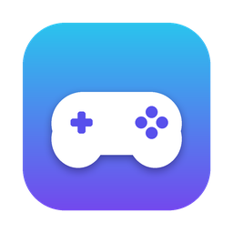
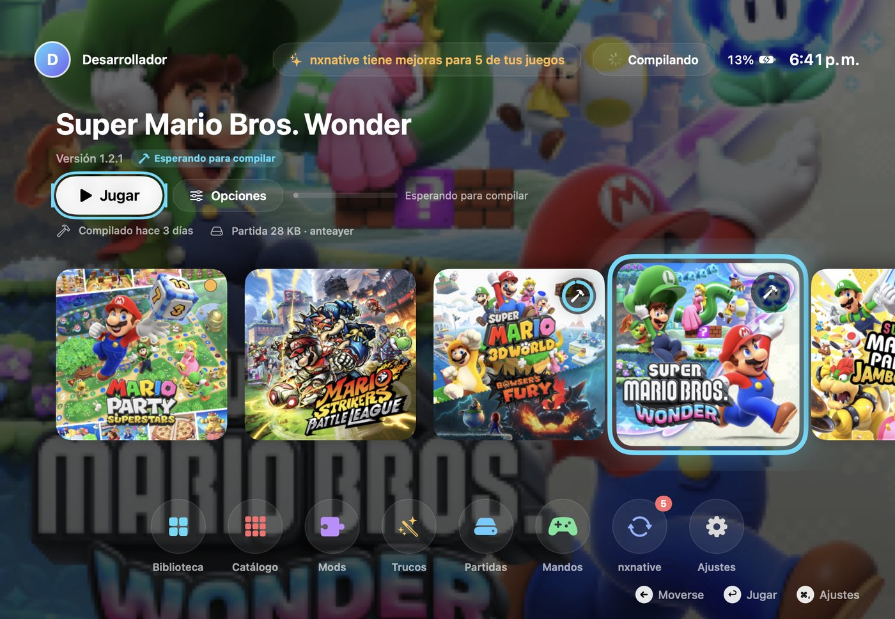
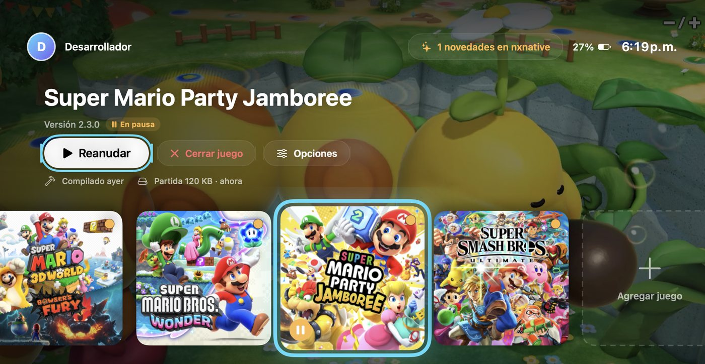
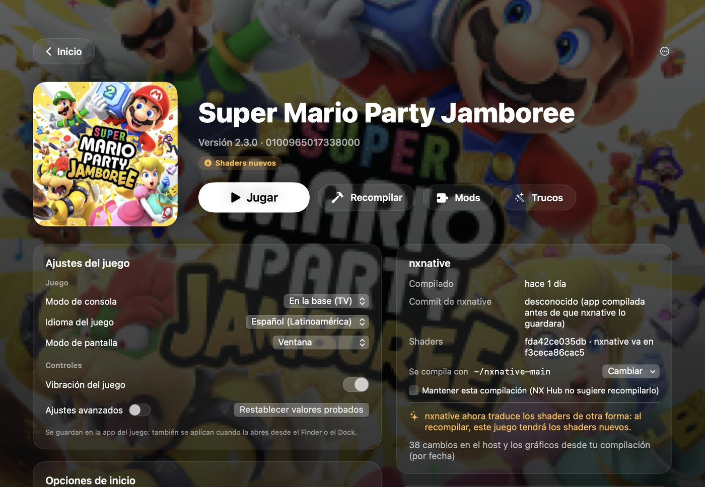
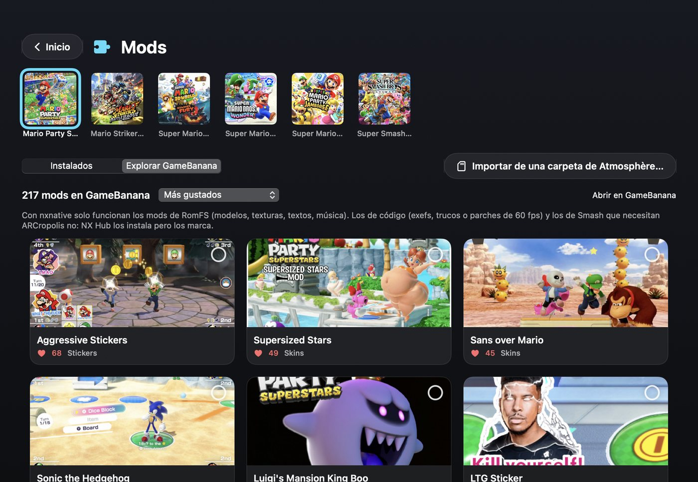
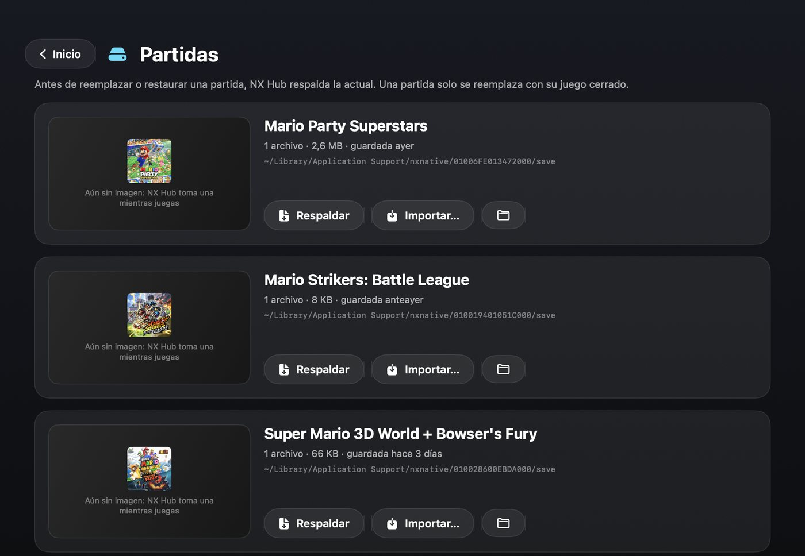
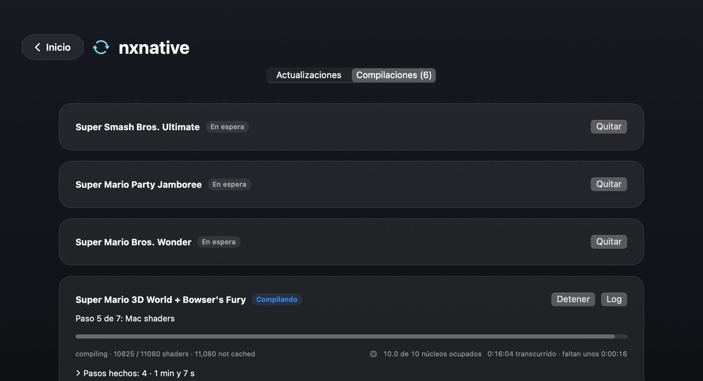
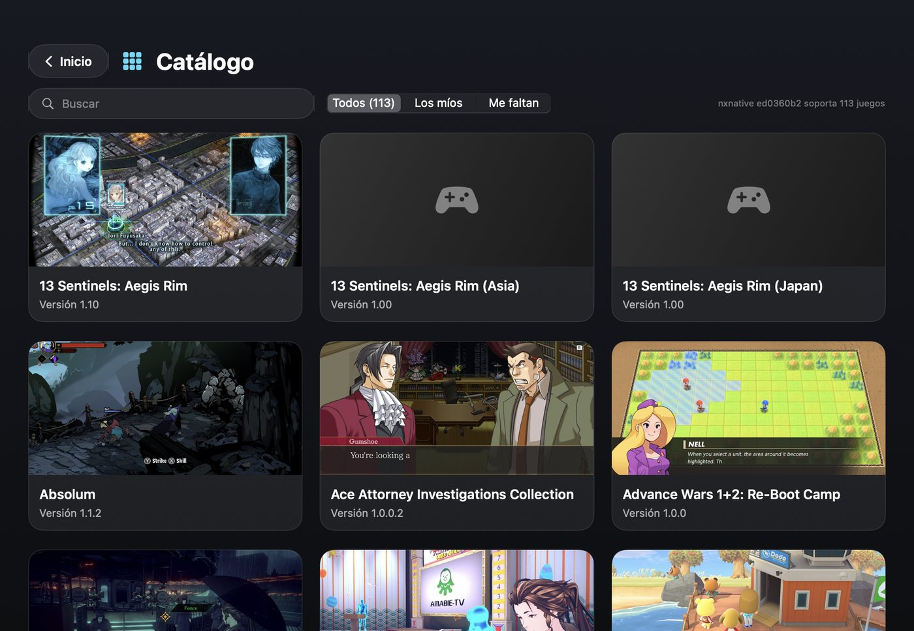

<p align="center">
  
</p>

<h1 align="center">NX Hub</h1>

<p align="center">
  A couch-friendly home screen for the Switch games you build with <a href="https://github.com/seedds/nxnative">nxnative</a> on your Mac.
</p>

<p align="center">
  
  
  
  
  <a href="LICENSE"></a>
</p>

<p align="center">
  <a href="#what-you-get">Features</a> ·
  <a href="#getting-started">Getting started</a> ·
  <a href="#how-it-talks-to-nxnative">Under the hood</a> ·
  <a href="#troubleshooting">Troubleshooting</a> ·
  <a href="#guía-rápida-en-español">Español</a>
</p>

<p align="center">
  
</p>

nxnative turns a Switch game you own into a native Mac app: the game's own ARM code runs on Apple silicon and its graphics are rebuilt for Metal. The toolchain is great, but day to day it means a terminal, a folder of NSPs and a handful of environment variables.

NX Hub puts a console on top of it. Your games live on one screen, you play and pause them with a controller, each game gets its mods, cheats and saves, and there's one place to see when nxnative improved something for your games and rebuild them.

NX Hub doesn't fork or patch nxnative. It drives your official checkout through the interface nxnative documents for front ends ([docs/frontends.md](https://github.com/seedds/nxnative/blob/main/docs/frontends.md)), so whatever lands upstream reaches your games with the next rebuild.

> [!IMPORTANT]
> **Bring your own games.** NX Hub doesn't include, download or share games, keys or firmware. You need dumps of games you own and the `prod.keys` of your own console.

## What you get

<table>
  <tr>
    <td width="50%"><br><sub><b>Home inside a game.</b> NX Hub comes back with the game paused and a picture of where you were.</sub></td>
    <td width="50%"><br><sub><b>One page per game.</b> Its own settings, what nxnative changed for it, mods, cheats and saves.</sub></td>
  </tr>
  <tr>
    <td width="50%"><br><sub><b>Mods from GameBanana.</b> Nothing is picked until you pick it.</sub></td>
    <td width="50%"><br><sub><b>Saves in one place.</b> Back up, restore or bring one from another tool.</sub></td>
  </tr>
  <tr>
    <td width="50%"><br><sub><b>Builds you can follow.</b> Progress, the time of each step and how many cores it keeps busy.</sub></td>
    <td width="50%"><br><sub><b>Catalog.</b> Every game nxnative supports; add yours from here.</sub></td>
  </tr>
</table>

### Play like on a console

- A start screen with big tiles, the selected game's art lighting the room, a dock, the clock and your battery. It moves with the D-pad or stick, A, B, X, Y, + and −, or with the keyboard.
- Every tile says where the game stands: ready, building (with its progress), waiting for its turn, new profile or new shaders upstream, playing, paused.
- **The Home button works inside the game** (PS, Xbox or Pro Controller). The game pauses and NX Hub comes forward with it selected; A or Home goes back to it, X closes it after asking.
- **Where you left off.** While a game started from NX Hub runs, NX Hub keeps a picture of it, every couple of minutes and whenever you press Home. You see it on the start screen, on the game's page and next to its save; each save backup keeps the picture of its moment.

### One page per game

- The game's own settings (graphics, controls, performance), read from the app's `launcher.json` and saved where the app reads them, so they also apply when you open the app from Finder. **Settings › All games** applies one choice to every game at once.
- Launch options: extra `KEY=VALUE` switches only for starts from NX Hub, for diagnostics or settings a game has no row for.
- What nxnative changed for this game since your build, with links to the commits.

### Keep up with nxnative

- Checks GitHub, shows which new commits touch your games or the engine, and updates your checkout.
- Tells you which games are worth rebuilding: a change to the game's profile, or (if you want) a new shader translation. Any game can keep the build it has.
- A build queue with live progress, the time of each step and the cores in use. A running build carries on if you quit NX Hub, and the queue picks up where it was when you open it again. Builds can wait for the night, and the Mac stays awake while they run.
- Before a build starts, anything left running from an earlier build of the same game is stopped, so two builds never step on each other's files.

### Mods, cheats and saves

- **Mods.** Add folders or zip, 7z and rar archives per game, turn them on and off, and set which one wins. Browse GameBanana for the selected game, or import what's on your Atmosphère SD card (`atmosphere/contents/<title ID>`); imported mods start turned off.
- **Cheats.** Atmosphère-format cheat files, matched to the game's build, toggled one by one and applied while the game runs. Experimental.
- **Saves.** Every game's save with its picture: back it up, restore a backup, or replace it with a save from another tool (the current one is backed up first). Optionally, a backup each time you play.
- **Controllers.** A tester that shows each button with the name nxnative gives it, the sticks, triggers, gyro, rumble and player order.

NX Hub speaks English and Spanish and follows the Mac's language; **Settings › Interface** changes it.

## Getting started

### What you need

- A Mac with Apple silicon and macOS 14 Sonoma or later, with Xcode (nxnative compiles the shaders with Xcode's Metal compiler).
- A working nxnative checkout. Clone [seedds/nxnative](https://github.com/seedds/nxnative) and follow its README until its NSP script builds a game from the terminal; NX Hub uses the same Python environment.
- Your games as NSP, XCI, NSZ or XCZ (base game, update and DLC), one folder per game, and your `prod.keys`.

### Build NX Hub

There is no prebuilt release yet. From a clone of this repository:

```sh
scripts/build_app.sh            # builds "NX Hub.app" in this folder
scripts/build_app.sh --install  # and copies it to /Applications
```

The script signs the app with a certificate it makes once for your Mac (kept in `.signing/`, never committed), so macOS remembers the folders you let NX Hub open from one build to the next.

### First launch

Open **Settings** (⌘,):

1. **Library** — the folder that holds your game folders (Downloads by default). Apps already in /Applications are found as well.
2. **nxnative and builds** — your nxnative checkout, the Python it uses and your `prod.keys`.
3. Back on the start screen, pick a game and press **A**. Built games start right away; the rest build first.

The first build of a game is the long one: every shader is translated and compiled for Metal. Later builds reuse what didn't change; when the shaders stay the same, a rebuild can take a minute or two.

### Controller and keyboard

| On the start screen | Controller | Keyboard |
| :-- | :-: | :-: |
| Move | D-pad · left stick | arrow keys |
| Play · resume · open | A | Return |
| Back | B | Esc |
| Game page, or close the running game | X | |
| Rebuild the selected game | Y | |
| Game page | + | |
| Settings | − | ⌘, |
| Back to the paused game | Home | |

## How it talks to nxnative

| NX Hub | What it uses in nxnative |
| :-- | :-- |
| Game settings | `Contents/Resources/dm/launcher.json` and the app's saved choices (`launcher.<VAR>` in its preferences domain) |
| Play | `open <app> --args --no-launcher`, plus the launch environment |
| Mods | `DM_ROMFS_OVERLAY`, folders whose files replace the game's RomFS files |
| Pictures and the Home pause | `DM_CTL`, the host's control file (`shot <path>` saves the next frame); the pause stops the game's process and resumes it |
| Builds | `scripts/build_ipa_from_nsp.py --platform mac-app --progress json` |
| Updates | git on your checkout; `dm/games/<title ID>/` tells which commits touch a game and `dm/gfx/nvn/dmsh_chain.h` when shaders are translated differently |
| Catalog | `dm/games/*/game.tsv` and the pictures in nxnative's docs |

## Limits worth knowing

- **Mods.** Only RomFS mods apply: textures, models, text, music. Code mods (exefs, IPS, 60 fps patches) don't, because nxnative compiles the game's code ahead of time, and Smash mods that need ARCropolis don't load either.
- **Cheats** write into the running game from outside. Cheats that change values work best; cheats that patch code may not.
- **Pausing** stops the game's process until you resume it. The game is told it lost focus first, as on the console.
- **Joy-Con-only motion modes** (some Super Mario Party Jamboree minigames, for instance) don't work yet: nxnative presents every controller as a Pro Controller.
- **Build time** depends on your Mac: the shader step keeps every core busy. The quickest build is the one you skip, which is why NX Hub shows what changed and lets a game keep its build.

## Troubleshooting

<details>
<summary>macOS asks for the Downloads folder again after every build</summary>

That happens with ad-hoc signed builds: each one looks like a new app to macOS. `scripts/build_app.sh` signs with a local certificate that stays the same, so approve the access once more after switching and it won't ask again.
</details>

<details>
<summary>A build fails with <code>FileNotFoundError</code> in <code>dmsh_build.log</code></summary>

Two builds of the same game were running in its folder at the same time, for example one left running by an older NX Hub. Each deletes the other's files. NX Hub now stops leftovers before it builds; start the build again.
</details>

<details>
<summary>The Home button doesn't bring NX Hub back</summary>

Check **Settings › Interface › While you play**. It works for games started from NX Hub, or running while NX Hub is open.
</details>

<details>
<summary>GameBanana shows the wrong game, or no mods</summary>

Click the game name next to the mod count and pick the right one. Some games have no mods there yet.
</details>

<details>
<summary>Where does NX Hub keep things?</summary>

Mods, cheats, save backups, pictures and build history are in `~/Library/Application Support/NX Hub`, build logs in `~/Library/Logs/NX Hub`. Games keep their saves where nxnative puts them: `~/Library/Application Support/nxnative/<title ID>/save`. **Settings › Data and folders** opens each one.
</details>

## Project layout

```
Sources/NXHub/
  App/        entry point and the shared model: navigation, play, Home, night builds
  Models/     settings, games, nxnative's launcher.json, the catalog
  Services/   library scan, updates, builds, game sessions, mods, GameBanana, cheats, saves, controllers
  Views/      the start screen and every page
  Support/    shell, paths, localization, development tools
Resources/    Info.plist, entitlements, English and Spanish strings, icon
scripts/      build_app.sh (build and sign) · dev_watch.sh (rebuild on request while developing)
```

## Roadmap

- [ ] A Joy-Con / Pro Controller choice per game (needs support in nxnative's host)
- [ ] Signed, notarized releases
- [ ] Custom covers

## Credits

- [seedds/nxnative](https://github.com/seedds/nxnative) does the real work. NX Hub only drives it.
- The launchers that came first and showed what players wanted: [rennan101/nxnative_Launcher](https://github.com/rennan101/nxnative_Launcher), [LNPANDY/NX2Apple](https://github.com/LNPANDY/NX2Apple) and [varyform/nx-native-wrapper](https://github.com/varyform/nx-native-wrapper).
- [GameBanana](https://gamebanana.com) for its public API.
- Atmosphère's documentation of the cheat format. NX Hub's cheat engine is written from that description, not from Atmosphère's code.

## License

[MIT](LICENSE). NX Hub isn't affiliated with Nintendo; Nintendo Switch, the games and their artwork belong to their owners.

---

## Guía rápida en español

**NX Hub** es una pantalla de inicio estilo consola para los juegos de Switch que compilas con nxnative en tu Mac. No reemplaza a nxnative ni lo modifica: usa tu copia oficial y la maneja como nxnative documenta para los launchers.

> [!IMPORTANT]
> **Trae tus propios juegos.** NX Hub no incluye, descarga ni comparte juegos, llaves ni firmware. Necesitas copias de juegos que tengas y el `prod.keys` de tu consola.

### Qué hace

- Un inicio que se maneja con el mando: los juegos en grande, A para jugar, X para cerrar el que está abierto.
- **Botón Home (PS, Xbox) dentro del juego:** vuelves a NX Hub con el juego en pausa; A o Home lo reanuda.
- **Dónde quedaste:** una captura del juego que se ve en el inicio, en su página y junto a su partida.
- Los ajustes de cada juego (gráficos, controles, rendimiento) y ajustes para todos los juegos a la vez.
- **nxnative al día:** qué cambió para tus juegos, actualizar la copia y recompilar en cola, con el tiempo de cada paso y los núcleos que usó. También compilaciones de noche.
- Mods (carpetas, zip/7z/rar, GameBanana o tu SD de Atmosphère), trucos en formato Atmosphère (experimental), partidas con respaldo, restauración e importación, y un probador de mandos.

### Qué necesitas

- Un Mac con Apple silicon y macOS 14 o más nuevo, con Xcode.
- nxnative funcionando: clona [seedds/nxnative](https://github.com/seedds/nxnative) y sigue su README hasta compilar un juego desde la Terminal.
- Tus juegos en NSP, XCI, NSZ o XCZ, cada uno en su carpeta, y tu `prod.keys`.

### Instalar

```sh
scripts/build_app.sh --install
```

Compila "NX Hub.app" y la copia a Aplicaciones.

### Primeros pasos

1. **Ajustes › Biblioteca:** la carpeta que tiene las carpetas de tus juegos.
2. **Ajustes › nxnative y compilación:** tu copia de nxnative, el Python que usa y tu `prod.keys`.
3. En el inicio, elige un juego y presiona **A**. La primera compilación de cada juego es la larga (traduce y compila todos sus shaders); las siguientes reutilizan lo que no cambió.

### Consejos

- Los mods de código (exefs, parches de 60 fps) y los de Smash que piden ARCropolis no funcionan con nxnative; los de RomFS sí.
- ¿Las compilaciones tardan mucho? En **Ajustes › nxnative y compilación** puedes dejar de recompilar por cada cambio de shaders, mantener la compilación de los juegos que ya te van bien o dejar las compilaciones para la noche.
